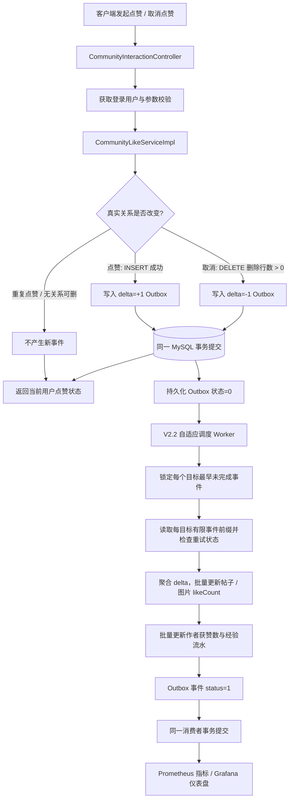
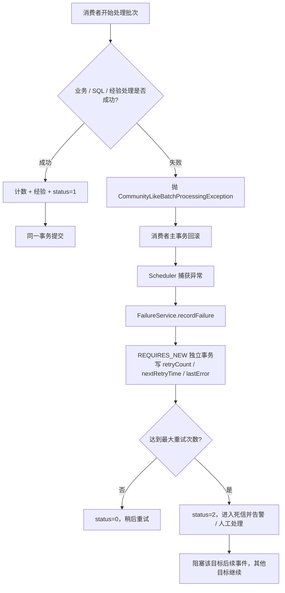

# 社区点赞链路技术方案梳理（V2.1 / V2.2）

> 项目：`picture-pro` 社区点赞与点赞计数异步化  
> 技术栈：Spring Boot 2.7.x、Java 17、MyBatis-Plus、MySQL 8.0+、Spring 事务、Micrometer、Prometheus、Grafana  
> 文档目的：把一次点赞从 HTTP 请求、数据库事务、Outbox 事件、异步消费者、失败重试，到最终计数一致性的完整链路讲清楚，为后续性能调优建立共同的技术基线。  
> 版本范围：依据已交付的 V2 Outbox、V2.1 顺序安全消费实现和 V2.2 自适应调度增量包梳理。若本地分支后续有额外修改，应以当前源码 diff 为准。

---

## 0. 先给结论：当前系统到底保证了什么？

当前方案不是“把点赞全部异步化”，而是**把核心点赞关系保持为同步数据库事实，把计数、作者获赞数与经验变化放到异步批处理链路**。

1. **点赞关系是业务事实**：用户是否点赞，以 `community_post_like` / `picture_like` 中的关系记录为准。
2. **点赞关系和 Outbox 事件在同一个 MySQL 事务中提交**：真实关系变更成功，必须同时产生一条计数事件；任何一方失败则整个事务回滚。
3. **点赞总数是冗余统计值**：帖子或图片上的 `likeCount` 由消费者异步更新，接口返回的总数允许短暂滞后；当前目标是把这种滞后控制在可接受范围内，而非每次请求都同步维护计数行。
4. **消费采用批处理**：一轮消费尽可能合并相同目标的增减量，以减少重复 `UPDATE`；同一目标的未完成事件不能随意越序处理，不同目标可以并行。
5. **计数、作者获赞数、经验流水和事件完成状态在消费者的同一事务中提交**：处理失败就全部回滚，再由独立事务记录重试状态。
6. **异常不会静默丢弃**：重试达到上限后进入死信（`status=2`），需要监控和人工处置；当前实现故意让同一目标后续事件不能跨过未解决的死信。

这套设计主要解决“业务关系必须可靠落库，但展示计数不必在每次点赞请求中立即精确更新”的矛盾。它减少了同步请求中的计数热点写入，并未消除点赞关系表、Outbox 表和索引的同步写入成本。

## 1. 整体架构与数据流

重要边界：

- HTTP 请求的核心同步事务只负责验证对象、改变点赞关系、插入 Outbox 事件、组成响应。
- 消费者不会直接“相信内存队列里的通知”；它从 MySQL Outbox 读取持久化事件，因此应用重启后仍可继续处理。
- Grafana 只展示状态，不参与业务正确性；Prometheus 抓取失败不能使点赞事务失败。
- 当前实现没有引入 Redis 计数缓冲或 RabbitMQ/RocketMQ。后续是否引入，需要先通过指标证明 MySQL 同步路径确实是瓶颈，再评估数据一致性和恢复成本。

## 2. 核心数据与不变量

### 2.1 两类数据

| 数据 | 代表表 / 字段 | 定位 | 是否作为事实来源 |
|---|---|---|---|
| 用户与目标的点赞关系 | `community_post_like`、`picture_like` | 某用户当前是否点赞某个帖子 / 公共图片 | 是 |
| Outbox 事件 | `like_event_outbox` | 记录发生过的关系状态变化及待处理状态 | 是（对计数事件处理而言） |
| 帖子点赞总数 | `community_post.likeCount` | 面向列表、详情展示的冗余计数 | 否，最终需与关系表核对 |
| 图片点赞总数 | `picture.likeCount` | 面向公共图片展示的冗余计数 | 否，最终需与关系表核对 |
| 作者获赞数 / 经验 / 经验流水 | `user_community_profile`、经验流水表 | 社区成长体系派生数据 | 由 Outbox 消费事务维护，需幂等 |

### 2.2 必须长期成立的业务不变量

- 同一用户对同一目标最多只有一条有效点赞关系。关系表应有相应的复合唯一索引，例如帖子点赞的 `(postId, userId)`、图片点赞的 `(pictureId, userId)`；请以实际数据库 DDL 确认为准。
- 只有成功插入点赞关系才产生 `delta=+1` 事件；只有成功删除关系（删除行数大于 0）才产生 `delta=-1` 事件。
- 关系变更与 Outbox 事件必须原子提交，不能出现关系已提交但事件没有提交的状态。
- 同一消费者批次中，目标计数更新、作者统计 / 经验变更和事件状态更新应共同提交或共同回滚。
- 已完成事件使用 `status=1`；待处理为 `status=0`；多次失败后进入死信 `status=2`。死信必须可观测、可恢复，不能被当成成功事件跳过。
- `likeCount` 是派生缓存，`GREATEST(0, ...)` 防止展示计数变负，但不能替代计数对账；它可能掩盖已有数据漂移。

## 3. 用户点赞：HTTP 到 MySQL 事务

### 3.1 入口与调用关系

当前帖子点赞接口位于 `CommunityInteractionController`：

- `POST /api/community/post/{postId}/like`
- `DELETE /api/community/post/{postId}/like`
- `GET /api/community/post/{postId}/like/status`

公共图片的接口为 `/api/community/picture/{pictureId}/like`，取消点赞使用 `DELETE`，状态查询使用 `/like/status`。控制器先调用 `userService.getLoginUser(request)` 得到已登录用户，再把业务交给 `CommunityLikeService`。评论仍留在原有 `CommunityInteractionService` 链路，避免混淆事务边界。

### 3.2 点赞帖子：成功路径

对应代码：`service/impl/CommunityLikeServiceImpl.java` 的 `likePost` 方法。

1. **开启事务**：`@Transactional(rollbackFor = Exception.class)`。本方法对普通异常也要求回滚。
2. **验证用户与帖子**：确认用户已登录，帖子 ID 合法，帖子已发布且未逻辑删除；禁止给自己的帖子点赞。
3. **直接插入点赞关系**：尝试插入 `community_post_like(postId, userId, createTime)`。代码刻意不先 `SELECT` 判断，因为“先查后写”在并发下存在竞态；复合唯一索引才是最后一道并发去重约束。
4. **仅在插入成功时写 Outbox**：当影响行数为 1，插入 `like_event_outbox` 事件，`targetType=POST`、`targetId=postId`、`actorUserId=当前用户`、`ownerUserId=帖子作者`、`delta=+1`、`status=0`。
5. **组成响应**：返回 `CommunityLikeStatusVO`，其中 `likedByCurrentUser` 根据点赞关系读取，`likeCount` 来自帖子实体上的当前冗余计数。由于总数由异步消费者更新，因此这个 `likeCount` 可能暂时落后于刚刚提交的关系变更。
6. **提交事务**：点赞关系与 Outbox 事件一起提交。只有事务提交后，消费者才会从其他事务中读取到这条事件。

#### 重复点赞为什么不重复计数？

如果同一用户并发重复点赞，数据库唯一索引可能触发 `DuplicateKeyException`。服务只捕获“插入点赞关系”这一处的重复键异常，并返回当前状态，不再写新的 Outbox 事件。Outbox 插入不在这个捕获块中；若 Outbox 插入失败，异常向外传播，关系插入也会随外层事务回滚。

这比在应用层先查点赞关系再插入更稳健：并发正确性由数据库唯一约束最终保障，并且只有真实状态变化会产生一个增量事件。

### 3.3 取消点赞：成功路径

对应 `unlikePost` 方法。

1. 开启事务并校验用户、帖子状态。
2. 根据 `(postId, userId)` 删除关系记录。
3. 只有删除行数 `deleted > 0` 时，才插入 `delta=-1` 的 Outbox 事件。
4. 如果关系本来就不存在，删除行数为 0，不产生事件。重复取消点赞不会重复扣减总数。
5. 响应仍然通过关系读取得到当前用户是否点赞，同时读取可能滞后的 `likeCount`。
6. 关系删除与 `delta=-1` 事件共同提交。

### 3.4 公共图片点赞

`likePublicPicture` / `unlikePublicPicture` 的事务原则完全相同，但会先验证图片是否存在、是否为公共图片、审核状态是否通过、是否未删除；并禁止用户给自己的图片点赞。图片计数更新目标是 `picture.likeCount`。

### 3.5 请求成功意味着什么、不意味着什么

| 请求响应成功后 | 当前设计是否保证 |
|---|---|
| 用户点赞关系已在 MySQL 中提交 | 是 |
| 对应 Outbox 事件已可靠提交 | 是（两者处于同一事务） |
| 返回的点赞总数立刻等于关系表 COUNT | 不保证，计数是最终一致 |
| 作者获赞数与经验已同步更新完成 | 不保证，交由消费者异步完成 |
| 单个 Outbox 事件一定只尝试一次 | 不保证，失败时会重试 |
| 重试不会重复应用一个已成功提交的计数批次 | 在计数 / 经验 / `status=1` 同事务提交的前提下有效；必须避免把事务外副作用放入处理逻辑 |

## 4. Outbox 事件表与事务 Outbox 模式

### 4.1 事件字段

`like_event_outbox` 记录每次真实的点赞关系变化。主要字段如下：

| 字段 | 含义 |
|---|---|
| `id` | MyBatis-Plus `ASSIGN_ID` 生成的事件 ID；当前消费者按此 ID 排序 |
| `targetType` / `targetId` | 目标是帖子 `POST` 还是图片 `PICTURE`，以及目标 ID |
| `actorUserId` | 发起点赞 / 取消点赞的用户 |
| `ownerUserId` | 事件创建时记录的作者 / 所有者快照，用于维护作者统计与经验 |
| `delta` | `+1` 代表关系新增，`-1` 代表关系删除 |
| `status` | `0` 待处理，`1` 已完成，`2` 死信 |
| `retryCount` | 已记录的失败次数 |
| `nextRetryTime` | 允许再次处理的最早时间 |
| `lastError` | 最近一次处理失败摘要，最多 500 个字符 |
| `createTime` / `processedTime` | 创建时间和成功处理时间 |

迁移 SQL 还建立了用于状态、目标与作者查询的索引，例如 `(status,id)`、`(status,nextRetryTime,id)`、`(targetType,targetId,id)`、`(ownerUserId,id)`。实际性能仍需通过数据库 `EXPLAIN` 和运行时指标验证，索引存在并不等于查询一定高效。

### 4.2 为什么选择事务 Outbox，而不是在请求里直接异步提交？

如果业务代码先提交点赞关系，再调用一个线程池任务或消息发送：

- 数据库已提交、应用在发消息前崩溃，会导致计数事件丢失；
- 消息已发送、数据库事务后续回滚，消费者可能处理一条实际没有发生的点赞；
- 使用简单的 `@Async` 并不能自动解决这两类双写不一致。

事务 Outbox 把“关系变化”和“待处理事件”放在一个数据库事务中。二者只能一起成功，或者一起回滚。后台消费者只要持续扫描 Outbox，就能在应用重启后继续处理。

它的代价是：每个真实点赞状态变化仍需同步写关系表和 Outbox 表；消费者还要额外查询和更新事件。因此 Outbox 是可靠性与吞吐之间的折中，不是完全消除数据库写负载。

### 4.3 为什么此阶段不直接上 Redis / MQ？

目前 MySQL 既是关系事实源，也是 Outbox 持久化介质，数据路径相对简单，失败恢复和对账较直接。Redis 计数器、Bitmap/Set 或 MQ 可以成为后续方案，但如果将点赞状态的事实来源迁移到 Redis，就必须另外设计：持久化与故障恢复、Redis/MySQL 双写原子性、去重键、消息重放、取消点赞顺序、定期对账和灾难恢复。不能只把写请求改成 `INCR` 或塞入队列，就认为可靠性问题已经解决。

## 5. V2.1 / V2.2 消费者：调度、锁定、批处理

### 5.1 V2.2 自适应调度器的职责

主要代码：

- `job/CommunityLikeOutboxScheduler.java`
- `job/AdaptivePollDelayPolicy.java`
- `config/CommunityLikeSchedulingConfig.java`
- `service/impl/CommunityLikeOutboxPollMetrics.java`

每个 worker 维护自己的状态与下一次计划任务。它执行一次 `processor.processNextBatch()`，本轮结束后根据结果安排自己的下一次执行，不采用固定间隔无条件轮询。

当前初始策略：

| 本轮结果 | 下一轮间隔 |
|---|---:|
| 刚启动的 worker | 按 worker 顺序错开启动，默认每个 worker 相差 25 ms |
| 有事件成功处理 | 1 ms 后续跑 |
| 空轮询 | 指数退避：25、50、100、200、400、500 ms，达到上限后不再增加 |
| 空轮询抖动 | 在允许范围内加入约 ±10% 随机抖动，降低 worker 同步唤醒概率 |
| 本轮异常 | 1000 ms 后重试调度 |

参数都可在 `application.yml` 中配置。它的目标是减少**空闲**时期无效查询，同时在存在待处理事件时快速续跑。自适应退避本身不会加快一条慢 SQL，也不能消除高负载下的热点行锁。

实现方式是任务执行完再为同一个 worker 安排下一次任务，因此单个 worker 不会主动重叠执行自己的下一轮；不同 worker 之间可以并行。如果系统其他地方也有 `@Scheduled` 任务，要检查 `SchedulingConfigurer` 对全局调度器的设置，确认这些任务是否与 Outbox worker 共用线程池。

### 5.2 为什么先锁定每个目标的最早未完成事件？

主要代码：`CommunityLikeOutboxMapper.selectPendingTargetHeads`。

查询会尝试选出：

- `status=0`；
- `nextRetryTime` 为空或已到期；
- 同一 `(targetType,targetId)` 下不存在更早的、`status <> 1` 的事件；
- 按 ID 排序并限制一轮领取的目标数量；
- 使用 `FOR UPDATE SKIP LOCKED` 锁定本轮选中的事件头。

`SKIP LOCKED` 的目标是让多个 worker 尽量领取不同目标，而不是在同一批事件头上相互等待。事件头锁在消费者事务结束前持有，因此同一个目标的后续事件不应由另一个 worker 越过头事件处理。

死信 `status=2` 也被视为尚未完成的前序事件。这样会阻塞该目标后续事件，但不会因此阻塞所有其他目标。

**并行度边界**：同一目标为了保持前序约束通常只能由一个 worker 在同一时刻推进；总体并行度主要来自不同目标的数量。比如只压测 1 个帖子，4 个 worker 不代表同一帖子可以被 4 个 worker 同时消费。若一次领取 20 个目标而实际只有 5 个活跃目标，一个 worker 也可能一次锁住这 5 个目标的 head，使其他 worker 暂时没有可领取的目标。是否需要调整 `target-batch-size`，应结合各 worker 的吞吐和积压指标实测。

### 5.3 第二步：获取每个目标有限的事件前缀

`CommunityLikeOutboxMapper.selectEventsForTargets` 使用 `ROW_NUMBER() OVER (PARTITION BY targetType, targetId ORDER BY id)` 为每个目标内的未完成事件排序，并通过 `max-events-per-target` 限制每个目标单轮读取数量。重试未到期事件和死信也会进入“未完成序列”，用于判断是否需要阻断更晚事件。

Java 方法 `CommunityLikeOutboxProcessor.filterProcessablePrefix` 按事件 ID 排序，对每个目标从头开始检查：

- 状态为 `0` 且重试时间已到：纳入可处理前缀；
- 遇到未到重试时间的事件或死信：该目标在这一事件处停止，后面更晚的事件本轮也不处理；
- 其他目标仍可继续处理。

这段规则修复了“较晚的取消点赞 `-1` 因为被另一个 worker 先取到而越过较早点赞 `+1`”这类乱序风险。当前实现把 `id` 当作同目标事件顺序的排序依据；跨多实例、时钟漂移或 ID 分配与事务提交次序不完全一致时，严格事件次序仍值得做专门的并发集成测试，不能仅凭无数据库的排序单元测试就宣称所有部署形态下都得到数学上的提交顺序保证。

当前 SQL 使用 MySQL 8.0+ 的窗口函数和锁定读语法。涉及窗口函数、派生表与 `FOR UPDATE` 的锁定行为，必须在实际 MySQL 8 环境做并发集成测试；静态看 SQL 或只跑 Java 单元测试不足以验证真实行锁语义。

### 5.4 第三步：合并增减量，减少更新语句

`CommunityLikeOutboxProcessor.processNextBatch()` 收集本轮可处理事件，把它们按目标聚合：

- 帖子事件汇总到 `postDeltas[targetId]`；
- 图片事件汇总到 `pictureDeltas[targetId]`；
- 同一批内某个目标 `+1` 和 `-1` 相互抵消，最终增量为 0 时不发起无意义的目标计数 `UPDATE`，但相应事件仍会被确认完成；
- 批次里引用的帖子 / 图片先做存在性检查；不存在则抛出异常，避免事件永远更新不到目标却被标记成功；
- 使用一条 `UPDATE ... CASE id WHEN ...` 批量更新多个目标的 `likeCount`，并用 `GREATEST(0, COALESCE(likeCount,0)+delta)` 防止计数变成负数。

这比逐事件逐目标执行 `UPDATE` 更容易合并重复目标写入，能减少数据库往返。但批次太大也会延长事务、持有更多行锁、增加单次回滚成本。因此 `target-batch-size`（每轮目标数）和 `max-events-per-target`（每目标事件上限）是两种不同维度的参数，不应混为一个“batch size”。在当前默认值 20 和 100 的情况下，理论上单轮候选事件规模可以接近 20×100；实际处理数取决于到期前缀和目标数据分布。

### 5.5 第四步：同步维护作者获赞数与经验流水

消费者调用 `CommunityExperienceService.processLikeEvents(events)`，并与计数更新共用外层事务。

实现原则：

- 按作者聚合 `receivedLikeCount` 的正负增量，同一批里每位作者尽量只更新一次档案；
- 按用户 ID 从小到大锁定作者档案，降低多个消费者以不同顺序加锁导致死锁的概率；
- 对真实的正向点赞事件生成经验流水候选；
- 使用业务事件键（帖子形如 `POST_RECEIVED_LIKE:<postId>:<actorUserId>`，图片形如 `PICTURE_RECEIVED_LIKE:<pictureId>:<actorUserId>`）去重，避免相同用户对同一目标取消后再次点赞而重复获得同一项“首次获赞”经验；
- 取消点赞会扣减作者当前获赞数，但不会回收已经授予的历史经验。这属于当前经验规则，应与产品规则保持一致。

经验流水的幂等性还依赖经验记录表对事件键的唯一约束。请以实际表 DDL 确认唯一索引存在。

### 5.6 第五步：标记完成与提交

计数、作者统计和经验流水处理完后，消费者将本批 `like_event_outbox` 对应事件从 `status=0` 更新为 `status=1`，写入 `processedTime`，清除错误和下次重试时间，并检查实际更新行数等于预期事件数。若行数不一致就抛异常。

整个 `processNextBatch()` 由 `@Transactional(rollbackFor = Exception.class)` 管理。因而以下操作处于一个本地数据库事务里：

1. 锁定并读取事件；
2. 更新帖子 / 图片计数；
3. 写作者统计、经验档案与经验流水；
4. 将 Outbox 事件标为完成。

只要任何一步抛出异常并向事务代理外传播，上述写入应整体回滚。事务提交后，该批事件状态和统计值一起可见。这里的“幂等”不是说函数永远不会被重复调用，而是利用事务与状态标记防止已成功提交的事件被正常再次执行；事务之外的副作用必须另行设计幂等。

## 6. 异常处理：从批次失败到重试，再到死信

### 6.1 为什么错误记录必须在独立事务里？

消费者在一次批处理中更新计数或经验失败时，首先必须回滚业务批次。如果失败原因、重试时间也写在同一个即将回滚的事务里，那些错误记录也会跟着回滚，消费者无法记住失败次数。

因此 `CommunityLikeOutboxFailureService.recordFailure` 使用 `@Transactional(propagation = REQUIRES_NEW)`，在原业务事务回滚后单独开启事务，写入重试信息。

### 6.2 当前重试策略

重试时间按照 `retryCount` 使用固定的分段退避，当前 mapper SQL 对应大致规则：

| 当前失败前的 retryCount | 下一次允许重试时间间隔 |
|---:|---:|
| 0 | 1 秒后 |
| 1 | 5 秒后 |
| 2、3、4 | 15 秒后 |
| 5 及以上、尚未达到上限 | 60 秒后 |

`retryCount + 1 >= maxRetries` 时将状态更新成 `status=2`；默认 `max-retries=10`。错误信息最多保存 500 个字符，避免把过长堆栈写进业务表。

发生数据库死锁、SQL 异常、无效事件、目标被物理删除、经验流水约束异常等问题，都可能使整个选中的消费批次回滚。当前批次级处理的优点是状态简单、事务一致；代价是一个事件失败可能使同批其他事件也一起重试。

### 6.3 死信为什么阻塞同一目标后续事件？

假设事件如下：

| 事件 ID（示例） | 目标 | delta | 状态 |
|---:|---|---:|---|
| 100 | POST:900 | +1 | 已完成 |
| 101 | POST:900 | -1 | 死信 |
| 102 | POST:900 | +1 | 待处理 |
| 103 | POST:901 | +1 | 待处理 |

如果事件 102 越过事件 101，统计计数可能与关系变化顺序脱节。当前实现会暂缓 `POST:900` 的事件 102，但允许另一个目标 `POST:901` 的事件 103 继续处理。因此死信应当被监控与人工修复，不能通过删除死信行或把它随意改为完成来“清理队列”。

### 6.4 失败处理本身也会失败

如果消费者主事务回滚后，独立的 `recordFailure` 事务也因数据库不可用、锁等待或连接池耗尽而失败，代码会记录错误日志，但重试状态可能没有写成功。原事件仍可能保留为待处理状态，后续调度器再次读到它。此时要重点观察数据库恢复后是否发生短时间重复失败，不能只看 dead-letter 数量。

### 6.5 死信处置流程

1. 从 Grafana 或 SQL 找到死信数量与具体事件：目标类型、目标 ID、事件 ID、`lastError`、`retryCount`。
2. 判断是临时基础设施问题、非法事件数据、目标被物理删除，还是经验表 / SQL 约束问题。
3. 先在开发环境修复根因并确认该事件可以被安全重放。
4. 核对对应目标的关系表真实数量、`likeCount` 和作者统计值。
5. 在备份或维护窗口制定明确的数据修复方案，再重置事件或通过专用管理流程重放；不要直接批量删死信。
6. 重放后核对计数与业务事件键，确保没有重复发放经验或重复改变计数。

## 7. 当前监控：Prometheus 和 Grafana 各负责什么

Prometheus 负责定期抓取 Spring Boot Actuator / Micrometer 导出的时序指标；Grafana 用查询结果展示趋势和告警。它们不是事件队列，也不会控制消费者。

当前方案包含两组主要指标：

- **批处理层指标（V2.1）**：pending 数、dead 数、最老待处理年龄、已处理事件数、批次耗时、失败批次数。
- **调度层指标（V2.2）**：每个 worker 的轮询次数、空轮询次数、失败轮询次数、处理事件数、轮询时长、下一次延迟。

还应结合 Spring Boot 常规指标观察：HTTP 请求持续时间、JVM CPU / 内存 / GC、Tomcat 线程、Hikari 活跃与等待连接数。数据库侧还需观察 MySQL CPU、InnoDB Buffer Pool 命中与物理读、慢 SQL、锁等待、事务持续时间和磁盘 I/O。不是所有数据库指标都会自动出现在应用的 Prometheus endpoint；MySQL 侧通常需要单独的 exporter 或数据库诊断工具。

### 推荐的关键图表

| 图表 | 为什么重要 | 异常时优先排查 |
|---|---|---|
| 点赞 API RPS 与 P95/P99 | 观察入口吞吐与尾延迟 | Tomcat、事务、数据库、锁等待 |
| Outbox pending 与 oldest pending age | 判断积压是否在增长、是否拖过 0.5–2 秒目标 | 消费速率、死信阻塞、SQL 慢查询 |
| 新增事件速率 vs 已处理事件速率 | 判断生产是否长期超过消费能力 | 消费者并行度、批次耗时、数据库更新能力 |
| 每个 worker 的处理事件速率 | 观察 worker 是否负载不均、是否只有一个 worker 在工作 | 目标数量、批次领取量、死锁/锁等待 |
| 空轮询比例与下一次延迟 | 验证自适应退避是否真的减少空闲查询 | 退避状态更新、是否存在频繁错误轮询 |
| Hikari active / pending / max | 判断应用线程是否等连接 | 事务时长、连接池大小、SQL 阻塞 |
| JVM CPU、GC、Tomcat busy threads | 区分应用资源饱和与数据库瓶颈 | 对象分配、日志、线程池与 CPU |
| MySQL CPU、锁等待、物理读 | 验证数据库随机 I/O / 行锁的假设 | 执行计划、索引、缓冲池、热点行 |

不要给指标添加 `userId`、`postId` 或 `pictureId` 等高基数标签，否则时间序列数量可能急剧增长。具体某条事件应通过日志或 SQL 排障，不应通过为每个目标创建一条 Prometheus 时间序列实现。

## 8. 对一致性与数据漂移的处理

### 8.1 最终一致性是设计选择，不是数据永远不会出错

由于点赞总数异步更新，关系表与 `likeCount` 在某个短时间窗口内不相等是允许的。但当消费者排空队列、没有死信、系统稳定后，冗余计数应当与关系表的真实计数收敛。

### 8.2 定期对账

使用 `sql/like_counter_reconciliation.sql` 检查图片和帖子的 `likeCount` 与点赞关系表聚合数量是否一致。大数据量环境不要不评估影响就直接全表 `GROUP BY`；应先用只读副本 / 低峰进行验证，必要时按 ID 范围分批统计回填。

对账需要分别看：

- 关系表真实数量；
- 目标表 `likeCount`；
- Outbox pending / dead 事件；
- 作者 `receivedLikeCount`；
- 经验流水中的幂等事件键。

不能仅仅把 `likeCount` 直接设成关系表 `COUNT(*)` 就结束：如果 Outbox 里还有未完成事件，回填与消费者并发运行可能导致新的计数差异；应在维护窗口协调回填和消费。

## 9. 对当前性能结论的审慎判断

你总结的四个瓶颈方向是很好的排查假设，但需要区分“数据已经证明”与“需要证据验证”。

### 9.1 “多目标离散随机写触发大量随机 I/O”尚未证实

当前结果确实显示部分多目标场景尾延迟显著变差，但仅凭 k6 摘要不能证明是 InnoDB Buffer Pool 装不下数据页，也不能证明磁盘随机 I/O 是主因。特别是 100 RPS 多目标数据中，中位延迟约 10.7 ms、P90 约 18.8 ms，而最大值达到 2.6 秒，表现更像一部分请求遇到长等待，而不是所有请求都遭受同等的随机 I/O 成本。

验证方法：同时观察 MySQL CPU、Buffer Pool 物理读、磁盘 IOPS / latency、行锁等待、慢 SQL、连接池 pending，以及具体 SQL 的 `EXPLAIN`。若物理读或锁等待没有随着压测明显增加，就不能把瓶颈归因于随机 I/O。

### 9.2 “Hikari 默认 10 个连接”不能直接假定

当前基础 `application.yml` 没显式定义 `spring.datasource.hikari.maximum-pool-size`，数据库连接配置可能来自 `application-local.yml` 或默认值。应先查看应用启动时的有效配置和 Hikari 指标，再决定是否调到 30–50。增大连接池有时会减少应用侧排队，但如果 MySQL 已经被锁等待或 CPU 饱和，增加连接反而可能提高争用。

### 9.3 `dropped_iterations` 证明压测没有完整发出目标迭代，不等于证明 OS Socket 到达上限

1000-b / 1000-c 的 VU 接近或达到 400，上下文中又有大量 dropped iterations，这证明当前测试的到达率执行器无法完整启动计划中的迭代。可能原因包括：响应变慢导致在途请求增加、最大 VU 不足、压测机 CPU 资源不足或服务端排队。仅凭这些指标并不能认定 TCP 端口、文件描述符或操作系统调度是瓶颈；应分别监控压测机和服务端资源，最好让 k6 与后端分开部署。

### 9.4 混合场景并非“稳如磐石”

1000-c 仍出现约 17,931 次 dropped iterations，P95 约 841 ms、中位数约 364 ms，以及 36 次 HTTP 失败。它相对 1000-b 的表现可能更好，但远不能称为稳定承载目标 1000 RPS。

### 9.5 结果对照必须统一条件

当前不同测试的 VU 上限有 255、220、400 等差异，部分测试持续时间和准备数据也可能不同。在确认测试持续时间、rate executor、预分配与最大 VU、目标分布、账号数量、JVM 暖机、队列是否排空、数据库状态和失败阈值一致之前，不应把所有延迟差异都解释成代码改动导致。

## 10. 当前方案的边界与后续审查点（本章不直接做调优改造）

这份技术梳理的目的不是马上更换架构，而是明确未来应该验证什么。以下点适合下一轮逐项分析：

1. **热点目标与有限目标的并行度**：一目标只允许一个 worker 推进；少数目标时，目标领取批次可能被单个 worker 包揽。需要从 worker 指标确认负载分布。
2. **目标事件排序的严格性**：当前以 Outbox ID 作为同目标顺序键。多实例下应通过并发集成测试验证 ID 顺序与实际关系变化顺序是否一致；如果必须严格按目标序列排序，可评估显式 `targetVersion` / 每目标序列号或其他数据库序列化方案。
3. **`GREATEST(0, ...)` 与数据漂移**：它可以防止负数，但会让负向更新被截断；需要依赖对账告警发现计数不一致。
4. **批次事务大小**：20 个目标、每目标最多 100 个事件，可能让一轮涉及较多事件；批次过大可减少往返，但会增加锁持有时间和失败重放成本。需通过批次耗时与 MySQL 锁等待判断。
5. **Outbox 表长期增长**：已完成事件持续保留会增加存储和索引规模。后续需要规划归档 / 清理策略，但必须先明确审计保留期、对账需求和死信处置需要，不能简单删历史数据。
6. **全局调度池配置**：当前 `CommunityLikeSchedulingConfig` 通过 `SchedulingConfigurer` 设置 task registrar 的全局 scheduler。若项目还有其他定时任务，要确认它们是否共享这组线程，并避免互相抢占。
7. **消费者失败批次范围**：当前一个事件异常可能回滚本批全部事件。后续可评估批次拆分或毒丸事件隔离，但必须保持同目标顺序并防止失败事件被静默越过。
8. **监控故障不等于业务故障**：Micrometer 记录异常被捕获并打印 warning，以避免指标故障直接停止 worker；但关键业务错误仍必须有日志、重试和死信告警。
9. **数据库事务外副作用**：当前计数 / 经验主要是数据库写入，放在同一事务中。若未来添加 MQ、邮件、通知等外部副作用，不能直接把不可回滚的外部调用塞进事务方法；应另外使用 Outbox 或幂等消费者。
10. **高负载请求路径仍有同步 DB 操作**：请求需要读取目标、写关系、写 Outbox，并读取关系状态；异步化的是计数和经验。后续应量化每个步骤耗时，避免误认为当前 API 已经不再依赖数据库。

## 11. 推荐的排障顺序

发生吞吐下降时，按以下顺序调查，避免一次改变多个变量：

1. **确认压测有效**：`dropped_iterations` 是否为 0；实际迭代速率是否达到目标；VU 是否频繁触顶；测试机是否饱和。
2. **定位入口延迟**：比对 HTTP P50 / P95 / P99、Tomcat busy threads、JVM CPU / GC。
3. **定位数据库等待**：Hikari pending、活跃连接、慢 SQL、事务时间、锁等待、物理读与磁盘 I/O。
4. **定位异步积压**：pending 曲线、oldest age、生产速率 vs 消费速率、dead 数量、每 worker 处理速率。
5. **选择单一变量实验**：每轮仅变更一个参数（例如目标领取数量、每目标最大事件数或连接池大小），保持其它条件相同。
6. **压测后核对一致性**：等待队列排空后，对账点赞关系数量、目标 `likeCount`、作者获赞数和经验流水。
7. **记录版本和结果**：保存 Git commit、配置快照、压测参数、Grafana 截图和 k6 JSON，避免只凭印象比较。

## 12. 当前技术方案的选择理由总结

| 方案选择 | 为什么选 | 需要接受的代价 / 边界 |
|---|---|---|
| 点赞关系同步写 MySQL | 当前点赞状态需要可靠且明确的事实来源；关系表可做用户级幂等与查询 | 每个请求仍有同步 DB 写入成本 |
| 唯一索引处理重复点赞 | 数据库最终仲裁并发重复写，避免先查后写的竞态 | 必须保证实际 DDL 有正确唯一索引 |
| 关系与 Outbox 同事务 | 消除“关系已提交但事件丢失”的双写窗口 | 每次有效状态变化需要额外写 Outbox |
| `likeCount` 异步更新 | 降低请求路径对热点计数行的同步竞争，允许短暂滞后 | 读到的总数可能短时不精确，需要监控与对账 |
| 消费者批量合并 delta | 同批同目标的多次变化可合并，减少 SQL 更新次数 | 批次越大，事务越重、锁持有可能越长 |
| 同目标顺序约束 + 不同目标并行 | 避免重试、取消点赞等事件越序导致计数漂移，同时保留跨目标并行 | 并行度受活跃目标数和领取策略限制 |
| 失败重试 + 死信 | 临时故障可自动恢复，持续异常不会无限高速重试 | 死信会阻塞相应目标，必须有告警、处置和重放流程 |
| 自适应退避 | 空闲时减少无效轮询，有事件时快速续跑 | 需要确认高负载期间没有过度查询和排队；它不是吞吐量的万能优化 |
| Prometheus + Grafana | 把吞吐、延迟、积压和资源放在统一时间轴分析 | 监控需额外部署，数据库侧指标可能需要单独 exporter |

## 附录 A：代码阅读路线

按以下顺序读源码，能最容易理解完整链路：

1. `controller/CommunityInteractionController.java`：HTTP 路由、登录用户获取、调用新点赞服务。
2. `service/CommunityLikeService.java` 与 `service/impl/CommunityLikeServiceImpl.java`：点赞 / 取消点赞同步事务。
3. `model/entity/CommunityLikeOutboxEvent.java` 与 `sql/like_outbox_migration.sql`：事件表及状态定义。
4. `job/CommunityLikeOutboxScheduler.java`、`job/AdaptivePollDelayPolicy.java`：V2.2 的 worker 调度与退避。
5. `mapper/CommunityLikeOutboxMapper.java`：锁定、事件前缀、批量计数更新、失败状态 SQL。
6. `service/impl/CommunityLikeOutboxProcessor.java`：一批事件的事务与业务处理顺序。
7. `service/impl/CommunityLikeOutboxFailureService.java` 与 `exception/CommunityLikeBatchProcessingException.java`：回滚后的独立失败记录。
8. `service/impl/CommunityExperienceServiceImpl.java`：作者统计和经验幂等键。
9. `service/impl/CommunityLikeOutboxMetrics.java`、`service/impl/CommunityLikeOutboxPollMetrics.java`：Outbox 与调度指标。
10. `sql/like_counter_reconciliation.sql`：最终计数对账。

## 附录 B：上线 / 压测前检查清单

- [ ] MySQL 版本满足当前 SQL 要求（MySQL 8.0+）。
- [ ] 帖子点赞和图片点赞的复合唯一索引已确认。
- [ ] 经验流水事件键唯一约束已确认。
- [ ] 点赞关系表、Outbox 表及目标计数使用同一数据库事务管理器 / 数据源。
- [ ] `application-local.yml` 中真实 Hikari 配置已检查，不能靠默认值猜测。
- [ ] MyBatis SQL stdout 日志在性能测试中关闭，避免日志污染测试。
- [ ] Prometheus `/api/actuator/prometheus` 只能由受信网络访问；Grafana 已替换默认口令。
- [ ] 测试使用专用账号和帖子；所有测试目标真实可访问。
- [ ] 每轮测试后等待 Outbox pending 排空，检查 dead 事件与最老事件年龄。
- [ ] 保存 k6 原始输出和 JSON 摘要，同时记录服务端 / 数据库指标。
- [ ] 压测结束后运行计数对账，并确认作者经验没有重复发放。

---

**文档说明**：本方案描述的是 V2.1/V2.2 已交付代码包的设计意图和实现路径，并包含需要在真实 MySQL 8 环境验证的边界项。静态代码审阅、Java 单元测试与真实多线程数据库集成测试不是同一层级的证据；涉及锁语义、并发顺序、SQL 执行计划和压测容量的结论，仍应以本地环境验证结果为准。
